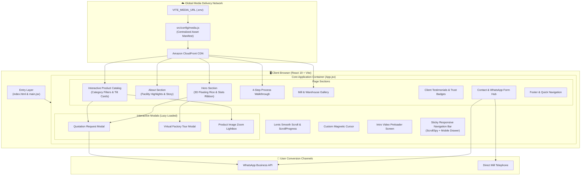
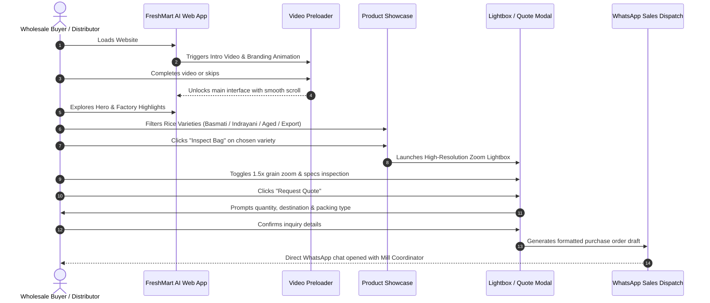
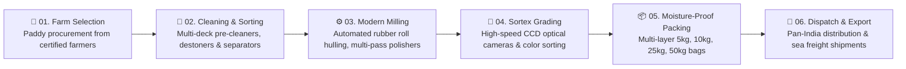
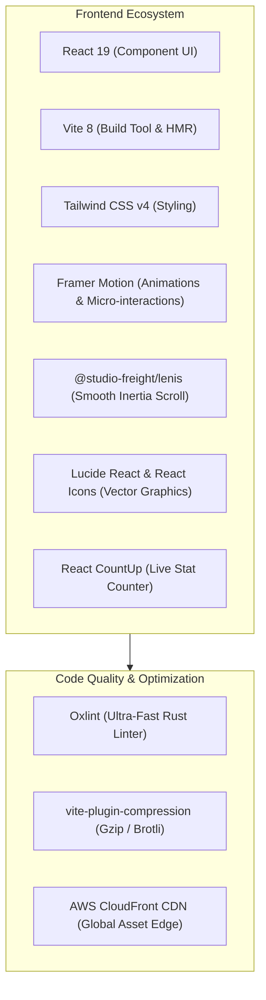

# 🌾 Shree Swami Samarth Rice Mill

<div align="center">


**Harvesting & Milling Excellence Since 1998**  
*State-of-the-Art Japanese Sortex Milling • 100% Pure & Hygienic • Domestic & Global Export*

[](https://react.dev/)
[](https://vitejs.dev/)
[](https://tailwindcss.com/)
[](https://www.framer.com/motion/)
[](https://github.com/darkroomengineering/lenis)
[](https://aws.amazon.com/cloudfront/)
[](LICENSE)

[Explore Products](#-featured-product-collection) • [Milling Process](#-rice-milling--quality-pipeline) • [System Architecture](#-system-architecture) • [Getting Started](#-getting-started) • [Contact Us](#-contact--trade-inquiries)

</div>

---

## 📖 Overview

**Shree Swami Samarth Rice Mill** is a modern, high-performance web platform presenting our legacy of premium rice processing and wholesale distribution based in Maharashtra, India. 

Equipped with modern Japanese Sortex milling technology, multi-stage destoners, and moisture-controlled polishing lines, our mill produces pristine Basmati, Indrayani, Kolam, Kolpi, and Jeera varieties for retail distributors, supermarkets, commercial banquet chains, and international export partners.

### 🌟 Key Platform Highlights
- **Fluid Visual Immersion:** Custom video preloader, smooth inertia scrolling powered by Lenis, dynamic cursor effects, and subtle grain particle physics.
- **Interactive 3D Product Showcase:** Tilt-responsive cards, category-filtering tabs, and full-resolution lightbox inspection with zoom-in magnification.
- **Factory Tour Modal & Storytelling:** Virtual tour video integrations capturing modern processing plant operations and packaging halls.
- **One-Click Quotation & WhatsApp Integration:** Rapid wholesale inquiry workflows routing custom specifications directly to mill sales coordinators.
- **CloudFront CDN Edge Architecture:** High-resolution WebP images and optimized MP4 assets streamed globally with sub-second latency.

---

## 🏛️ System Architecture

The following diagram illustrates the component architecture, data flow, media pipeline, and user interaction layers of the platform:



---

## 🔄 User Journey & Navigation Flow



---

## 🌾 Rice Milling & Quality Pipeline

Our grain processing methodology combines traditional agrarian heritage with computerized Japanese Sortex cleaning:



### Visual Process Stages

| Stage 01: Farm Selection | Stage 02: Cleaning & Sorting | Stage 03: Modern Milling | Stage 04: Quality Inspection |
| :---: | :---: | :---: | :---: |
|  |  |  |  |
| *Direct farmer procurement & sustainable grain selection.* | *Impurity removal, magnetic destoning & grain grading.* | *Uniform friction whitening and silk polishing.* | *Lab testing, moisture certification & zero-defect Sortex check.* |

---

## 📦 Featured Product Collection

Our collection features daily staples, vintage aged reserves, and long-grain biryani specialties:

| Product | Variety | Category | Grain Characteristics | Curing / Aging | Visual Inspection |
| :--- | :--- | :--- | :--- | :--- | :---: |
| **Basmati Rice** | Traditional Basmati | Royal Special | Extra-long slender grains, elongates up to 2x cooked | Naturally Aged |  |
| **Indrayani (Fresh)** | Maharashtra Fragrant | Daily Essential | Medium soft grains, sweet natural fragrance | Fresh Harvest |  |
| **Indrayani (Aged)** | Vintage Reserve | Connoisseur Choice | Firm texture, non-sticky cooking, deep nutty aroma | 18+ Months Cured |  |
| **Kolam Rice** | Traditional Kolam | Daily Table Rice | Slender light grain, quick cooking, easy digestion | Year Aged |  |
| **Kolpi Rice** | Premium Kolpi | Export Grade | Double silky polished, consistent micron grading | Sortex Cleaned |  |
| **Jeera 1008 (New)** | Micro Grain | Quick Cooking | Cumin-sized slender grain, delicate fragrance | Current Crop |  |
| **Jeera 1008 (Old)** | Cured Micro Grain | Chef's Selection | Fluffy separation, ideal for jeera rice and pulao | Aged 2 Years |  |
| **Basmati Steam** | Extra Long Steam | Banquets & Exports | Thermal steam conditioned for superior tensile strength | Steam Processed |  |

---

## 🏭 Mill Infrastructure & Processing Unit

<div align="center">


*State-of-the-art milling machinery, automated sorting towers, and climate-controlled warehouse silos.*

</div>

- **Processing Capacity:** High-throughput daily milling lines equipped with pneumatic grain elevators.
- **Dust-Free Environment:** Cyclonic air filtration systems ensuring sanitary processing conditions.
- **Packaging Lines:** Automated bagging machines providing 5kg, 10kg, 25kg, and 50kg moisture-barrier packaging.
- **Logistics Hub:** Direct highway connectivity (Ghoti-Shirdi Road) enabling rapid dispatch across Maharashtra, Gujarat, and major Indian ports.

---

## 🛠️ Technology Stack & Dependencies



| Technology | Version | Purpose |
| :--- | :--- | :--- |
| **React** | `^19.2.8` | Component architecture, state hooks, and Suspense lazy loading |
| **Vite** | `^8.2.0` | Ultra-fast local dev server and optimized production tree-shaking |
| **Tailwind CSS** | `^4.3.3` | Next-generation utility-first styling with high-performance CSS engine |
| **Framer Motion** | `^12.43.0` | Fluid scroll triggers, spring transitions, and interactive gesture handling |
| **@studio-freight/lenis**| `^1.0.42` | Native-feel inertia scrolling across all viewports and hardware |
| **Lucide React** | `^1.28.0` | Crisp, scalable iconography |
| **Oxlint** | `^1.75.0` | High-performance Rust-based static code analysis |
| **AWS CloudFront** | - | Edge media caching for high-bitrate video and WebP assets |

---

## 📁 Repository Directory Structure

```plaintext
freshmart-ai/
├── 📁 public/                     # Static assets & web manifests
│   ├── favicon.svg               # Brand vector favicon
│   ├── icons.svg                 # SVG sprite sheet
│   └── 📁 images/                # Local asset fallback folder
├── 📁 src/                        # Core application source code
│   ├── 📁 components/            # Modular React components
│   │   ├── 📁 About/             # Facility story & quality badges
│   │   ├── 📁 Contact/           # Contact cards & WhatsApp integration
│   │   ├── 📁 Distributor/       # Supply & distributor partner network
│   │   ├── 📁 FactoryModal/      # Virtual plant video modal
│   │   ├── 📁 Footer/            # Platform links & copyright info
│   │   ├── 📁 Gallery/           # Mill machinery & warehouse gallery
│   │   ├── 📁 Hero/              # Hero header, floating rice & statistics
│   │   ├── 📁 Intro/             # Intro video preloader screen
│   │   ├── 📁 Navbar/            # Navigation bar, mobile drawer, scroll spy
│   │   ├── 📁 Process/           # 4-stage interactive milling pipeline
│   │   ├── 📁 Products/          # Product catalog, category tabs & zoom modal
│   │   ├── 📁 QuoteModal/        # Quotation request form modal
│   │   ├── 📁 Testimonials/      # Customer & distributor reviews
│   │   ├── 📁 Trusted/           # Certifications & trust badges
│   │   ├── 📁 WhyChooseUs/       # Competitive advantages & metrics
│   │   └── 📁 common/            # CustomCursor, SmoothScroll, TiltCard, etc.
│   ├── 📁 config/                # Environment & media configuration
│   │   ├── config.js             # Base MEDIA_URL configuration
│   │   └── media.js              # Centralized CDN media asset mappings
│   ├── 📁 context/               # Global state contexts (Theme, UI)
│   ├── 📁 pages/                 # Route page components
│   ├── App.jsx                   # Root application layout & Suspense wrappers
│   ├── index.css                 # Global CSS tokens, fonts, and animation styles
│   └── main.jsx                  # React DOM root entry point
├── .env.example                  # Environment variable reference template
├── .oxlintrc.json                # Fast Rust-based linter rules
├── index.html                    # HTML entry point with preconnect & fonts
├── package.json                  # Dependencies and execution scripts
├── vercel.json                   # Edge routing & cache headers configuration
└── vite.config.js                # Vite build settings & React plugins
```

---

## 🚀 Getting Started

Follow these instructions to set up the project locally on your machine:

### 1. Prerequisites
- **Node.js**: `v18.0.0` or higher
- **Package Manager**: `npm`, `pnpm`, or `yarn`
- **Git** installed on your system

### 2. Clone the Repository
```bash
git clone https://github.com/parthkale3231/Rice_mill.git
cd Rice_mill
```

### 3. Install Dependencies
```bash
npm install
```

### 4. Configure Environment Variables
Copy the `.env.example` file to create your local `.env`:
```bash
cp .env.example .env
```

Set your Media CDN endpoint in `.env`:
```env
# Production Media CDN URL
VITE_MEDIA_URL=https://dhqenopo9lcuj.cloudfront.net
```
> **Note:** If `VITE_MEDIA_URL` is left empty, the application falls back to images located in the local `/public` directory.

### 5. Launch Development Server
```bash
npm run dev
```
Open your browser and navigate to `http://localhost:5173` to explore the live application with Hot Module Replacement (HMR).

### 6. Code Linting
Run Oxlint to check for code quality and potential issues:
```bash
npm run lint
```

### 7. Production Build
Compile and bundle the application with Brotli/Gzip compression:
```bash
npm run build
```
Preview the production build locally:
```bash
npm run preview
```

---

## ⚡ Performance & UX Optimizations

1. **Next-Gen WebP & CDN Streaming:**
   - All gallery and product photos use WebP compression.
   - Global AWS CloudFront CDN ensures rapid media delivery regardless of visitor location.
2. **Code Splitting via React 19 `lazy` & `Suspense`:**
   - Modals (`QuoteModal`, `FactoryModal`) and below-the-fold sections (`Process`, `Gallery`, `Testimonials`) load on demand to minimize initial JavaScript payloads.
3. **Inertia Scrolling with Lenis:**
   - Eliminates layout jank and provides unified 60/120 FPS scrolling across trackpads, mice, and mobile touchscreens.
4. **Vite Compression Plugin:**
   - Pre-compresses static assets during build time to enable instant HTTP transfer via reverse proxies or Vercel edge networks.
5. **SEO & Accessibility Ready:**
   - Semantic HTML5 structure, descriptive `aria-label` tags on all interactive buttons, DNS prefetching for Google Fonts, and high-priority image preloading.

---

## 📞 Contact & Trade Inquiries

We welcome wholesale inquiries, domestic dealership applications, and international export contracts.

<div align="center">

| Channel | Contact Details |
| :--- | :--- |
| **📍 Mill Address** | Shree Swami Samarth Rice Mill, Ghoti-Shirdi Rd, Maharashtra, India |
| **📞 Phone / WhatsApp** | [+91 8605194211](tel:+918605194211) / [+91 9370107793](tel:+919370107793) |
| **💬 Direct WhatsApp** | [Chat on WhatsApp](https://wa.me/918605194211) |
| **✉️ Email** | [info@ricesamarth.com](mailto:info@ricesamarth.com) |
| **🕒 Working Hours** | Monday – Saturday : 9:00 AM – 7:00 PM IST |

</div>

---

<div align="center">

Designed & Engineered with ❤️ for **Shree Swami Samarth Rice Mill**  
*© 1998 - 2026 Shree Swami Samarth Rice Mill. All Rights Reserved.*

</div>
